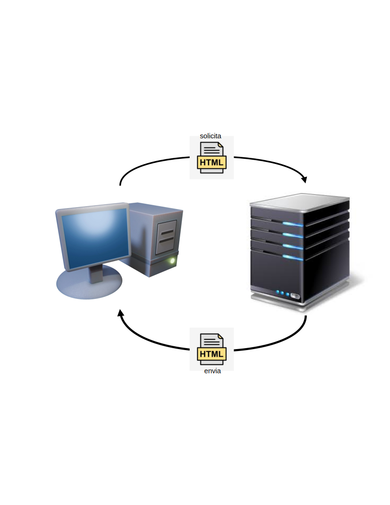

# Lección 1 — ¿Qué es el desarrollo web?

## ¿Qué es una página web?

Una página web es un documento que podemos visitar desde un navegador. Hoy veremos cómo llega a nuestra pantalla y cómo HTML y CSS participan en su creación.

---

## El rol del navegador

Aquí vemos un título, texto y un enlace. Todo aparece en el navegador, que interpreta los archivos de la página y nos permite interactuar con ellos.

```html
<h1>Mi primera web</h1>
<p>Hola, estoy aprendiendo.</p>
<a href=”url”>enlace</a>
```

---

## ¿Qué son HTML y CSS?

HTML, es un lenguaje de programacion basico con el cual se puede organizar el contenido de una página, como los títulos, párrafos y enlaces. CSS sirve para definer su apariencia: colores, fuentes y espacios. Se tratan de las dos bases de la creación de las paginas web, ambos son necesarios, ya que se complementan uno al otro.

---

## Estructura básica con HTML

En el editor ya tenemos un título y un párrafo escritos con HTML. Observa que el navegador los interpreta y muestra separados. Si cambiamos el texto del título, cambia también la vista previa.

```html
<h1>Titulo</h1>
<p>párrafo</p>
```

---

## Aplicando estilos con CSS

Ahora observemos el mismo contenido con una regla CSS. El color del título cambia, pero su texto permanece igual. Eso nos permite distinguir estructura de apariencia.

```css
h1 { color: #2435e8; }
```

---

## Estructura frente a diseño

Vamos a observar los diferentes elementos que tenemos en pantalla, primero tenemos al Titulo y al parrafo ambos forman parte de HTML, segundo las reglas de CSS aportan el diseño a la pagina HTML. Si llegamos a desactivar los estilos el texto que forma parte de HTML se mantiene, pero se mantiene bastante simple. Debido a esto es muy importante saber cómo se estructura un pagina web.

---

## ¿Cómo se carga un sitio web?

Cuando entramos a un sitio, el navegador solicita los recursos necesarios a un servidor, el cual provee los archivos HTML y CSS que el navegador requiera para representar la página.



