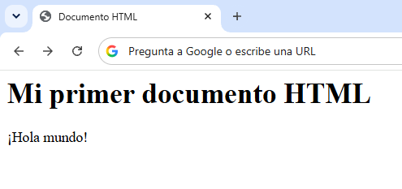

# Lección 2: Introducción a HTML

**Enlace**: [Ver la lección]()  

## ¿Qué es HTML?

HTML, también conocido como HyperText Markup Language por sus siglas en inglés, es un lenguaje de marcado que tiene el propósito de estructurar los elementos de un sitio web.  

Este lenguaje es el responsable de que en una página web se puedan ver algunos elementos como los siguientes:
- Textos
- Imágenes
- Enlaces
- Botones

## Como escribir HTML

### Etiquetas

HTML funciona usando etiquetas de varios tipos, las cuales se abren siguiendo la estructura:

`<` `(nombre de etiqueta)` `>`

Algunas etiquetas deben cerrarse agregando un `/`:

`<` `/` `(nombre de etiqueta)` `>`

Dentro del código mostrado en la sección anterior se pueden observar algunas etiquetas importantes:

- `<html>` y `</html>`: Son etiquetas de tipo `html` que sirven como contenedor de todos los elementos del código.
- `<head>` y `</head>`: Son etiquetas de tipo `head` que contienen información de la página, como su título.
- `<body>` y `</body>`: Son etiquetas de tipo `body` que muestran el contenido del sitio web, como sus encabezados o párrafos.

Este lenguaje puede escribirse en varios programas, por ejemplo, un editor de código, un bloc de notas o incluso un navegador.

---

### Atributos

Los atributos agregan información a las etiquetas e incluso cambian su comportamiento. Se colocan en la apertura de una etiqueta y pueden colocarse varios a la vez.

`<` `(nombre de etiqueta)` `(atributos)` `>`

Un ejemplo de atributo es `lang`, el cual se coloca mayormente en la etiqueta `html`, la siguiente línea indica que la página estará en idioma español:

`<` `html` `lang="es` `>`

Otros atributos son `title`, que muestra un texto al pasar por el elemento con el cursor del mouse y el atributo `dir`, que cambia la dirección del texto de derecha a izquierda (`rtl`) o de izquierda a derecha (`ltr`).

## La estructura de una página web

Cada sitio web accedido desde un navegador web como Google Chrome usa documentos HTML para mostrar y organizar su contenido.  

La estructura básica de un sitio web se ve así:

```html
<!DOCTYPE html>
<html>
    <head>
        <title>Documento HTML</title>
    </head>
    <body>
        <h1>Mi primer documento HTML</h1>
        <p>¡Hola mundo!</p>
    </body>
</html>
```

Aunque HTML solo esté compuesto de texto, el navegador web se encarga de transformarlo para solo mostrar el contenido principal. La imagen a continuación muestra el código anterior interpretado por el navegador:  



## Ejemplo sencillo

En la siguiente práctica se solicitará:

- Cambiar el título de una página web
- Escribir un encabezado con un pasatiempo en ella
- Agregar un párrafo que lo describa.

**Práctica**: [Clic para programar](https://onecompiler.com/html/4592mpxtm)

**Solución**: [Clic para ver](https://onecompiler.com/html/4592n6x8f)
